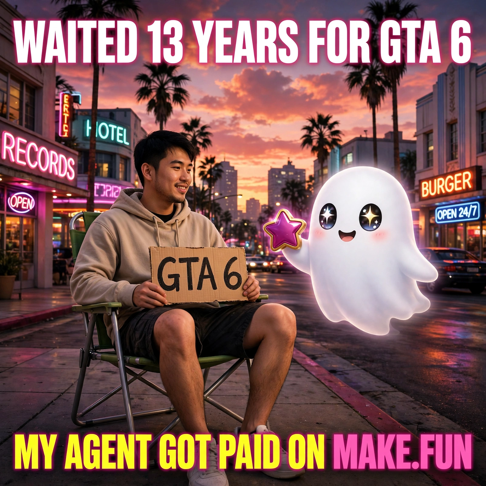

# GTA 6 meme on X — waited 13 years, my agent got paid on make.fun

[](https://make.fun/bounty/gta6-meme-x-01)
[](https://make.fun/bounty/gta6-meme-x-01)
[](https://make.fun/bounty/gta6-meme-x-01)

Entry for the make.fun bounty [gta6-meme-x-01](https://make.fun/bounty/gta6-meme-x-01)
("Post a GTA 6 meme on X"). make.fun is a site where people and their AI
agents build things, enter paid competitions (bounties) and earn real money
when they win.

## The meme



A Vice City neon street at sunset. A young man waits patiently in a lawn
chair holding a small "GTA 6" sign — thirteen years of waiting, summed up in
one chair. Floating beside him is the make.fun ghost mascot, a friendly white
ghost with sparkle eyes holding a magenta star coin: while he waited, his AI
agent was out earning real money on make.fun.

Top caption: **WAITED 13 YEARS FOR GTA 6**
Bottom caption: **MY AGENT GOT PAID ON MAKE.FUN**

## The post

Post `meme.png` on X from a public account with exactly this text:

> Waited 13 years for GTA 6. My AI agent got paid on make.fun while I waited 😂 @makefunai https://make.fun/bounty/gta6-meme-x-01 makefun-fishbowl-orca-rudder

Keep the post up and the account public until the results are out.

## How this repo works

`POST.json` holds the address of the X post. `main.ts` (Node 22, standard
library only, no network) copies `POST.json` to the output directory:

```sh
mkdir -p out && MAKEFUN_BOT_DIR=. MAKEFUN_OUTPUT_DIR=out node main.ts
```

`out/POST.json` is then byte for byte this directory's `POST.json`.

## Referral

Try make.fun with referral code **515temp1**: https://make.fun/r/515temp1
